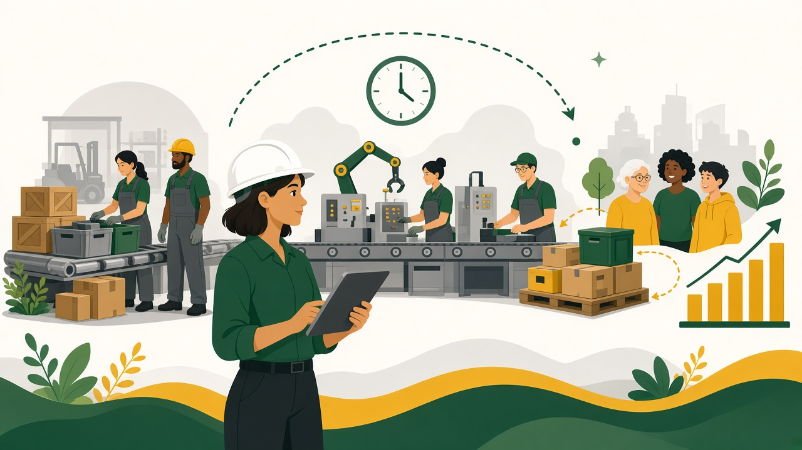

# What Is Industrial & Manufacturing Engineering? {#sec-week-01}

::: chapter-meta
[Week 1]{.pill} [Sample draft — replace with instructor draft]{.pill .pill-draft} [≈ 25 min read]{.pill}
:::

{.chapter-banner fig-alt="Illustration of an engineer observing a flow of materials, machines, and people that ends in finished products and satisfied customers."}

::: {.callout-important title="Learning objectives" icon="false"}
By the end of this week you should be able to:

1. Define industrial engineering and manufacturing engineering in your own words.
2. Describe at least three industries where IMEs work and what they do there.
3. Explain the terms throughput, cycle time, bottleneck, and utilization.
4. Find the bottleneck of a simple process and estimate its maximum throughput.
:::

::: {.story title="The engineer who redesigned the kitchen" source="https://www.americanhistory.si.edu/ontime/saving/kitchen.html" source-title="Smithsonian National Museum of American History"}
Lillian Gilbreth began her career studying factory and office work with her husband, Frank. Using film and multiple-exposure photographs, the couple broke jobs down into elemental motions they called [therbligs]{.term}, and then eliminated the wasted ones. After Frank died in 1924, Lillian applied the same [motion study]{.term} methods to housework [@smithsonian-gilbreth].

In the kitchen she placed the stove and counter side by side, put food storage above and pans below, and kept the refrigerator a step away. Cooks could then work in a tight loop instead of walking back and forth across the room [@sciam2023gilbreth]. If your kitchen has an L-, U-, or galley-shaped work area, you are living with her ideas.

**Why it matters:** IE isn't only about factories. Wherever people do work, there's a system that can be studied and improved.
:::

## Engineering systems, not just things

Most engineering disciplines are named after *what* they design. Civil engineers design structures, electrical engineers design circuits, and mechanical engineers design machines. Industrial engineers design **how everything works together**.

The Institute of Industrial and Systems Engineers (IISE) gives the field's classic definition:

> Industrial and systems engineering is concerned with the design, improvement and installation of integrated systems of people, materials, information, equipment and energy. [@iise-definition]

The key word is [system]{.term}. A hospital emergency department, an Amazon fulfillment center, and a combine assembly line are all systems. Each one transforms inputs into outputs through a series of steps, and each can be made safer, faster, cheaper, or more humane. An industrial engineer practices [systems thinking]{.term}, which means asking how a change in one place ripples through the whole system.

[Manufacturing engineering]{.term} is the closely related discipline that focuses on the *processes and equipment* that physically make products: machining, molding, welding, [additive manufacturing]{.term}, and [automation]{.term}. At NDSU, the two fields share a department because modern production needs both. Someone has to design the process, and someone has to design the system it runs in.

| | Industrial engineering | Manufacturing engineering |
|:--|:--|:--|
| **Central question** | How should the whole system be designed and run? | How should this product be made? |
| **Typical decisions** | Layout, staffing, scheduling, quality systems, supply chains | Process selection, tooling, machine programming, automation |
| **Example tools** | Process maps, simulation, statistics, optimization | CAD/CAM, [CNC]{.term} programming, process planning |
| **Works in** | Factories, hospitals, logistics, finance, government | Factories, suppliers, equipment builders |

: Two closely related fields {#tbl-ie-vs-me .striped}

## Where IMEs work

Because every organization runs on processes, IMEs work almost everywhere:

- **Manufacturing.** Agricultural equipment, aerospace, electronics, food processing, and medical devices.
- **Healthcare.** Reducing patient wait times, scheduling operating rooms, and preventing medication errors.
- **Logistics and e-commerce.** Designing warehouses, routing delivery fleets, and managing [inventory]{.term}.
- **Service and government.** Banks, airlines, theme parks, and public agencies all use IEs to improve service.

::: {.career title="Industrial engineers by the numbers" source="https://www.bls.gov/ooh/architecture-and-engineering/industrial-engineers.htm" source-title="U.S. Bureau of Labor Statistics, Occupational Outlook Handbook"}
According to the U.S. Bureau of Labor Statistics, industrial engineers held about **365,100 jobs** in 2025 and earned a **median annual wage of \$102,440**. Employment is projected to grow **12 percent from 2025 to 2035**, much faster than the average for all occupations [@bls2026ie].
:::

## How IMEs think: measure, model, improve

When an IME looks at a process, a few questions come first:

- How much does the system produce per hour? This is its [throughput]{.term}.
- How long does each step take? This is its [cycle time]{.term}.
- Which step limits the whole system? That step is the [bottleneck]{.term}.
- How busy is each resource? This is its [utilization]{.term}.

### Worked example: the morning coffee rush

A campus coffee cart has three steps. Each customer is served by one worker at each step.

```{mermaid}
%%| label: fig-coffee
%%| fig-cap: "Process flow at the campus coffee cart, with the time per customer at each step."
flowchart LR
  A([Customer<br/>arrives]) --> B[Take order<br/>30 s]
  B --> C[Make drink<br/>75 s]
  C --> D[Pay<br/>20 s]
  D --> E([Customer<br/>leaves])
  style C fill:#ffc82e,stroke:#0a5640,stroke-width:2px
```

Each step can serve at most $3600 / \text{time per customer}$ people per hour:

| Step | Time per customer | Max customers per hour |
|:--|--:|--:|
| Take order | 30 s | 120 |
| Make drink | 75 s | **48** |
| Pay | 20 s | 180 |

: Capacity of each step {#tbl-coffee}

The system can never go faster than its slowest step, so **making drinks is the bottleneck** and the cart serves at most 48 customers per hour (@tbl-coffee).

Now suppose 60 customers arrive per hour during the 8 a.m. rush. The [takt time]{.term}, the pace needed to keep up with demand, is

$$
\text{Takt time} = \frac{\text{available time}}{\text{demand}} = \frac{3600 \text{ s}}{60 \text{ customers}} = 60 \text{ s per customer}.
$$

Drink-making takes 75 s, which is longer than the 60 s takt time, so the line keeps growing. If a second barista is added, drinks are finished every 37.5 s on average, and the cart's capacity becomes $3600 / 37.5 = 96$ customers per hour. Each barista is then busy

$$
\text{Utilization} = \frac{60 \times 37.5}{3600} = 62.5\% \text{ of the time.}
$$

Find, measure, and relieve the bottleneck, then look for the next one. That habit is the core of the IE approach, and we'll come back to it with lean in Week 8 and simulation in Week 10.



## Your toolkit this semester

Along with learning about the profession, you'll build the computer skills engineers use daily:

- **Spreadsheets and Python** to calculate, analyze, and manage data (Weeks 11–12).
- **Project planning tools** such as a [Gantt chart]{.term} and the [critical path]{.term} (Week 13).
- **Technical writing and presentations** to communicate your results (Week 14).

::: {.activity title="Spot the system (10 minutes, pairs)"}
Pick a campus process you used this week, such as the dining center line, the bookstore checkout, or getting a parking permit.

1. List its **inputs**, **steps**, and **outputs**.
2. Estimate the time each step takes.
3. Which step do you think is the **bottleneck**? What is one change that would relieve it?

Be ready to share your process map with the class.
:::

## Key takeaways

- Industrial engineering designs and improves **integrated systems** of people, materials, information, equipment, and energy. Manufacturing engineering focuses on **how products are made**.
- IMEs work in nearly every sector: manufacturing, healthcare, logistics, service, and government.
- A system's throughput is limited by its **bottleneck**. Improving any other step won't increase output.
- Takt time connects the system to **customer demand**.

::: {.callout-tip title="Check your understanding" collapse="true"}
1. **In one sentence, how does industrial engineering differ from mechanical engineering?**
   *Mechanical engineering designs machines and devices. Industrial engineering designs the systems (people, equipment, information, materials) those machines operate within.*

2. **A process has steps of 40 s, 55 s, and 35 s. What is the bottleneck and the maximum hourly throughput?**
   *The 55 s step. $3600 / 55 \approx 65$ units per hour.*

3. **Demand is 80 units in a 4-hour shift. What is the takt time?**
   *$4 \times 3600 / 80 = 180$ s per unit.*
:::

::: keyterms
:::

## Further reading

- Kanigel's biography of Frederick Taylor tells the story of the birth of [scientific management]{.term} [@kanigel1997].
- The Gilbreths' own account of motion study is *Applied Motion Study* [@gilbreth1917].
- The *Handbook of Industrial Engineering* surveys the whole field [@salvendy2001].
